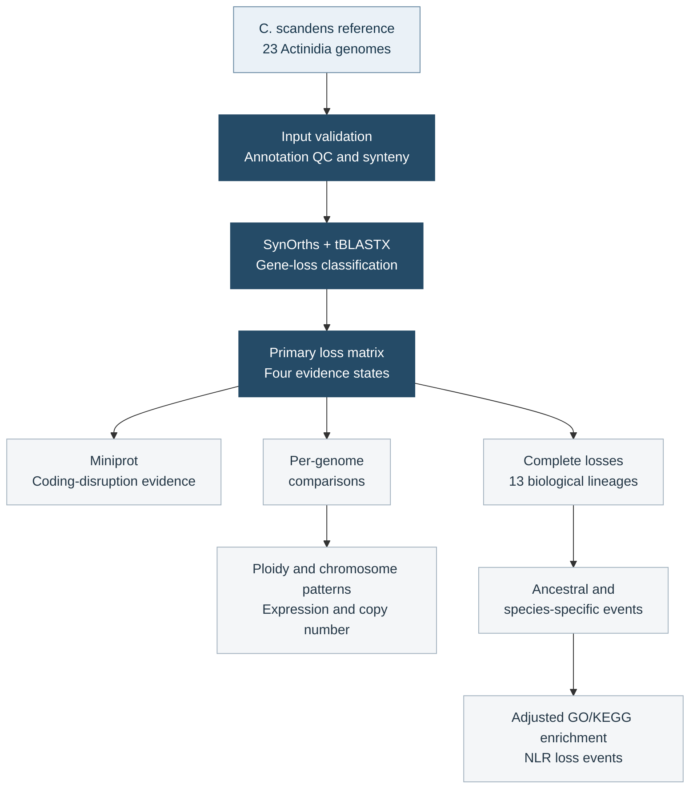

<div align="center">

# Gene loss in *Actinidia*

**Synteny-informed gene-loss analysis across diploid and polyploid genomes**

[](https://doi.org/10.1093/hr/uhag452)
[](https://doi.org/10.1093/hr/uhag452)
[](pyproject.toml)

[Overview](#overview) · [Workflow](#workflow) · [Quick start](#quick-start) · [Documentation](#documentation) · [Data](#data-and-results) · [Citation](#citation)

</div>

> **Published in *Horticulture Research* · 23 October 2026**<br>
> [Gene loss in polyploid *Actinidia* species inferred from the chromosome-level assembly of *Clematoclethra scandens*](https://doi.org/10.1093/hr/uhag452)<br>
> Yi Zhou, Yun Jia, Haodong Luo, Feng Cheng, Ying Zhang, Yanjun Zhou and Yongbo Liu.

## Overview

This repository provides the analysis code, configuration files, methods and
synthetic tests accompanying our study of gene loss in *Actinidia*. A
chromosome-level assembly of the sister-lineage species *Clematoclethra
scandens* provides the reference for identifying orthologs, classifying loss
states and tracing loss events across diploid and polyploid genomes.

| Reference genes evaluated | *Actinidia* genomes | Species represented | Biological lineages for event analysis |
| :---: | :---: | :---: | :---: |
| **35,547** | **23** | **12** | **13** |

The study examines three connected questions:

- **How are genes lost?** Distinguish decayed from deleted genes and assess
  frameshift and premature-stop evidence within the decayed class.
- **Where and when do losses occur?** Compare genomes and subgenomes, map
  ancestral and species-specific events, and examine chromosome-level and
  within-chromosome distributions.
- **Which gene properties and functions are associated with loss?** Evaluate
  expression and gene copy number, test covariate-adjusted GO and KEGG
  enrichment, and characterize NLR repertoires and loss events.

The published analysis found that decayed loss predominated, loss patterns
varied among genomes and chromosomal regions, and species-specific losses
showed recurrent translation- and mitochondrial-associated enrichment after
adjustment for expression and gene copy number. See the
[paper](https://doi.org/10.1093/hr/uhag452) for the complete results.

## Workflow



Companion workflows cover genome collinearity, species phylogeny, divergence
dating and gene-family evolution using JCVI, OrthoFinder, IQ-TREE,
ASTRAL-Pro, MCMCTree and CAFE5. The stage-by-stage protocol is documented in
[`docs/PIPELINE.md`](docs/PIPELINE.md).

### Loss states and analysis sets

| State | Evidence used in the primary classification |
| --- | --- |
| `retained` | Exact SynOrths-supported orthologous anchor |
| `decayed` | A missing-gene candidate with a genome-wide tBLASTX hit at identity ≥ 50%, bit score ≥ 50 and E-value < `1e-5` |
| `deleted` | A missing-gene candidate with no qualifying tBLASTX hit |
| `not_called_loss` | A comparison outside the resolved candidate scope |

Positive losses are **`decayed + deleted`**. Loss rates use
`retained + decayed + deleted` as the resolved denominator.

Miniprot alignments provide additional evidence for **frameshift-only,
in-frame-stop-only and combined** coding disruptions. Decayed genes meeting
the alignment and disruption criteria form the **strict pseudogenized
subset**; this evidence does not change the primary classification. Detection
of a residual homologous sequence alone does not confirm a coding disruption.

All **23 genomes** remain separate in per-genome comparisons. For functional
and NLR event analyses, haplotypes and subgenomes from the same species are
combined. The two parental haplomes of the F1 hybrid *A. zhejiangensis* remain
separate, giving **13 biological lineages**. Complete loss requires every
constituent genome to be decayed or deleted; mixed states represent partial or
homeolog-specific loss.

For functional enrichment, ancestral losses on the focal root-to-tip path are
excluded first. Complete species-specific losses form the foreground; other
eligible genes in the remaining risk set form the comparison background.
Logistic score tests adjust for four-tissue mean expression and *C. scandens*
gene copy number, defined as **CD-HIT 90% cluster size**. Details are given in
the [classification guide](docs/LOSS_CLASSIFICATION.md) and
[functional-analysis guide](docs/COVARIATE_ADJUSTED_FUNCTIONAL_ENRICHMENT.md).

## Quick start

**Requirements:** Python 3.10 or later. External bioinformatics tools are
installed separately for the stages that use them.

```bash
git clone https://github.com/lemonral/Actinidia-gene-loss.git
cd Actinidia-gene-loss

python3 -m venv .venv
source .venv/bin/activate
python -m pip install --upgrade pip
python -m pip install -e '.[all]'

geneloss --help
```

Run the synthetic test suite with:

```bash
python -m pytest -q
```

### Configure the data directory

Genomes and large intermediate files are stored outside the code repository.
Copy the configuration template and set `DATA_ROOT` to your data directory:

```bash
cp config/project.env.example config/project.env
```

```text
Actinidia-gene-loss/          code, configuration and documentation
actinidia_gene_loss_data/     external data directory
├── downloads/
├── raw/
├── standardized/
├── work/
├── results_large/
└── logs/
```

Public asset URLs, checksums, genome identities, biological groupings and
analysis parameters are declared in [`config/`](config/). See the
[data-layout guide](docs/DATA_LAYOUT.md) for storage and provenance conventions.

### Run individual stages

The `geneloss` command provides reusable core operations:

```bash
geneloss extract-annotation --help
geneloss normalize-synorth --help
geneloss call-candidates --help
geneloss classify-tblastx --help
geneloss build-loss-master --help
geneloss spatial-summary --help
```

Study-scale analyses run in stages using validated manifests. Representative
entry points include:

```bash
python scripts/qc/extract_primary_annotation.py --help
python scripts/gene_loss/compare_within_species_genome_units.py --help
python scripts/spatial/analyze_decayed_chromosome_distribution.py --help
python scripts/function/run_terminal_covariate_adjusted_enrichment.py --help
python scripts/statistics/compare_ploidy_loss_rates.py --help
python scripts/nlr/run_nlr_annotator_batch.py --help
```

> **Reproducing the published functional analysis:** use the 13-lineage
> biological-species profile below. The default 23-genome exploratory profile
> represents a different analysis set.

```text
--analysis-level biological_species
--terminal-node-type species_terminal
--expected-terminals 13
--expected-terminal-event-memberships 19192
```

External programs include BLAST+, Miniprot, minimap2, JCVI, BUSCO, SynOrths,
OrthoFinder, MAFFT, IQ-TREE 2, ASTRAL-Pro, PAML/MCMCTree, CAFE5 and
NLR-Annotator. Tool roles and validation requirements are described in the
[pipeline](docs/PIPELINE.md) and
[phylogeny toolchain](docs/PHYLOGENY_TOOLCHAIN.md).

Publication figure renderers use Arial regular, italic, bold and bold-italic
faces. If the fonts are installed outside standard system directories, set:

```bash
export ARIAL_FONT_DIR=/path/to/licensed/arial-font-files
```

## Repository structure

```text
Actinidia-gene-loss/
├── config/                   cohorts, parameters, manifests and mappings
├── docs/                     methods, evidence rules and workflow guides
├── scripts/
│   ├── qc/                   assembly, annotation, synteny and chromosome QC
│   ├── gene_loss/            loss matrices and genome/lineage summaries
│   ├── spatial/              chromosome and within-chromosome analyses
│   ├── downstream/           expression, copy number and event preparation
│   ├── function/             GO and KEGG enrichment
│   ├── statistics/           exact ploidy-group and related comparisons
│   ├── nlr/                  NLR repertoires, evidence and loss events
│   ├── phylogeny/            species trees, dating and CAFE5 workflows
│   └── figures/              publication figure renderers
├── src/geneloss_repro/        reusable Python package
├── tests/                    synthetic unit and regression tests
├── results/                  curated small tables and result-bundle guide
└── CITATION.cff               software and associated-paper citation metadata
```

## Documentation

| To explore… | Start here |
| --- | --- |
| Project organization and entry points | [Repository guide](docs/REPOSITORY_GUIDE.md) |
| The complete analysis workflow | [Pipeline](docs/PIPELINE.md) |
| Loss states, evidence and denominators | [Loss classification](docs/LOSS_CLASSIFICATION.md) |
| Chromosome and within-chromosome patterns | [Decayed-locus spatial analysis](docs/DECAYED_CHROMOSOME_POSITION_ANALYSIS.md) |
| Functional foregrounds, backgrounds and models | [Covariate-adjusted enrichment](docs/COVARIATE_ADJUSTED_FUNCTIONAL_ENRICHMENT.md) |
| Branch events and complementary functional analyses | [Tree-aware loss analysis](docs/TREE_AWARE_LOSS_FUNCTION.md) |
| Input storage and checksums | [Data layout](docs/DATA_LAYOUT.md) |
| Result provenance and validation | [Results provenance](docs/RESULTS_PROVENANCE.md) |

Analysis and figure changes are recorded in [`CHANGELOG.md`](CHANGELOG.md).

## Data and results

The repository contains code, configuration, documentation, synthetic tests
and selected small result tables. Genome assemblies, annotations, sequencing
reads and large intermediate outputs are stored separately. Public input
sources and checksums are recorded in [`config/`](config/); supplementary
tables and supporting information are available with the
[published article](https://doi.org/10.1093/hr/uhag452).

A curated figure bundle includes PNG and PDF figures, exact plot-data tables,
captions, validation summaries and checksum manifests. The bundle format is
described in [`results/README.md`](results/README.md).

Input validation checks sample identities, schemas, sequence sets, checksums
and expected record counts. Configuration files preserve the declared
biological groupings and parameters, while output manifests record input and
tool provenance. The tests use synthetic data and require no study genomes.

## Citation

If you use the code or results, please cite:

Zhou, Y., Jia, Y., Luo, H., Cheng, F., Zhang, Y., Zhou, Y. and Liu, Y. (2026).
**Gene loss in polyploid *Actinidia* species inferred from the chromosome-level
assembly of *Clematoclethra scandens*.** *Horticulture Research*, uhag452.
[https://doi.org/10.1093/hr/uhag452](https://doi.org/10.1093/hr/uhag452).

<details>
<summary>BibTeX</summary>

```bibtex
@article{zhou2026actinidiaGeneLoss,
  author  = {Zhou, Yi and Jia, Yun and Luo, Haodong and Cheng, Feng and
             Zhang, Ying and Zhou, Yanjun and Liu, Yongbo},
  title   = {Gene loss in polyploid {Actinidia} species inferred from the
             chromosome-level assembly of {Clematoclethra scandens}},
  journal = {Horticulture Research},
  year    = {2026},
  pages   = {uhag452},
  doi     = {10.1093/hr/uhag452},
  url     = {https://doi.org/10.1093/hr/uhag452}
}
```

</details>

Machine-readable citation metadata is provided in
[`CITATION.cff`](CITATION.cff).
